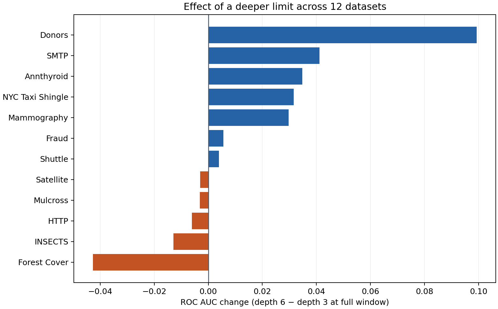

# 論文深度公式對照

兩組的視窗都固定為 2048，比較原始程式的 log₄ 和論文的 log₂。滿視窗時對應的深度門檻為 3 和 6。

實驗使用 11 份靜態資料及 INSECTS。兩組都用 32 棵樹、每批約 100 筆，並用相同的種子 0–4 配對。靜態資料依種子打亂，INSECTS 保留原順序並使用前 10 個特徵。[資料來源](https://github.com/ineveLoppiliF/Online-Isolation-Forest/tree/e528c86b77219791d026d732f618efb0c7bde3c1/datasets)

## 結果

| 資料集 | 筆數 | 原版深度 3 AUC | 論文深度 6 AUC | AUC 差值 | 論文深度 6勝出 |
|---|---:|---:|---:|---:|---:|
| Donors | 619,326 | 0.7469 | 0.8463 | +0.0993 | 3/5 |
| HTTP | 567,498 | 0.9965 | 0.9904 | -0.0061 | 0/5 |
| Forest Cover | 286,048 | 0.8736 | 0.8310 | -0.0426 | 1/5 |
| Fraud | 284,807 | 0.9393 | 0.9449 | +0.0056 | 3/5 |
| Mulcross | 262,144 | 0.9954 | 0.9922 | -0.0032 | 2/5 |
| SMTP | 95,156 | 0.8107 | 0.8518 | +0.0411 | 4/5 |
| Shuttle | 49,097 | 0.9901 | 0.9940 | +0.0039 | 4/5 |
| Mammography | 11,183 | 0.8406 | 0.8703 | +0.0297 | 4/5 |
| NYC Taxi Shingle | 10,273 | 0.5706 | 0.6021 | +0.0316 | 4/5 |
| Annthyroid | 7,200 | 0.6992 | 0.7339 | +0.0347 | 4/5 |
| Satellite | 6,435 | 0.6555 | 0.6525 | -0.0030 | 3/5 |
| INSECTS | 212,514 | 0.7789 | 0.7661 | -0.0129 | 3/5 |

表中 AUC 是各設定 5 次的整體 ROC AUC 中位數，差值為 論文深度 6 減 原版深度 3。勝出次數用相同種子逐對比較。

以「過半數資料集提升，且差值中位數大於零」判斷整體改善。結果為 **7 份提升、5 份下降、0 份持平**，差值中位數為 **+0.0048**。每份資料等權平均的差值為 +0.0149。這個設定在多數資料集上提升 AUC，仍有資料集退步。



圖中右側代表 AUC 提升，左側代表下降。每份資料只跑 5 個種子，反映同一批資料在不同亂數下的結果。Annthyroid 30 次結果和 INSECTS 視窗比較，見[個別實驗](experiment_report.md)。

## 重跑

```bash
OPENBLAS_NUM_THREADS=1 OMP_NUM_THREADS=1 python experiments/depth_benchmark.py
python experiments/depth_benchmark_report.py
```

[逐種子 AUC](experiment_evidence/depth_seed_auc.csv)
