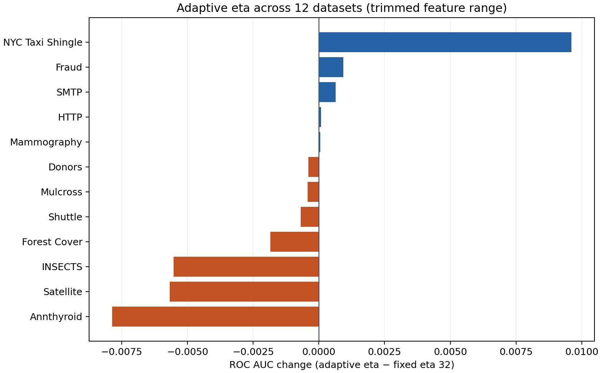

# 自動選擇切分門檻 η

論文第 6 節把自動選擇 $\eta$ 列為未來工作。$\eta$ 是葉節點分裂所需樣本數的基準。我們用資料集中程度選擇門檻，兩組都採用視窗 2048 和原始程式的 log₄ 深度公式。原版固定 $\eta=32$，自動版先用 32，之後每累積約一個視窗的新資料，就用最近 2048 筆重新估計。[論文](https://proceedings.mlr.press/v235/leveni24a.html)

以各特徵的四分位距除以第 5 到 95 百分位的範圍，再取中位數 $r$，令 $\eta=\max(8,\operatorname{round}(32\sqrt{1.8r}))$。跳過範圍為零的特徵。如果全數跳過，沿用 32。這樣可減少極端值把範圍拉大的影響。 計算只用特徵。中央資料越集中，門檻越小。均勻分布時門檻接近 32。

學習和遺忘使用自動 η，訓練的深度門檻把當時的 η 帶入原公式。評分用 32 計算葉節點路徑長度修正與分數正規化。

實驗使用 11 份靜態資料及 INSECTS。兩組都用 32 棵樹、每批約 100 筆，並用相同的種子 0–4 配對。靜態資料依種子打亂，INSECTS 保留原順序並使用前 10 個特徵。[資料來源](https://github.com/ineveLoppiliF/Online-Isolation-Forest/tree/e528c86b77219791d026d732f618efb0c7bde3c1/datasets)

## 結果

| 資料集 | 筆數 | 固定 η=32 AUC | 自動 η AUC | AUC 差值 | 自動 η勝出 | 自動 η 範圍 |
|---|---:|---:|---:|---:|---:|---:|
| Donors | 619,326 | 0.7469 | 0.7465 | -0.0004 | 1/5 | 22–35 |
| HTTP | 567,498 | 0.9965 | 0.9966 | +0.0001 | 3/5 | 29–32 |
| Forest Cover | 286,048 | 0.8736 | 0.8718 | -0.0018 | 2/5 | 26–32 |
| Fraud | 284,807 | 0.9393 | 0.9402 | +0.0009 | 2/5 | 25–32 |
| Mulcross | 262,144 | 0.9954 | 0.9949 | -0.0004 | 1/5 | 25–32 |
| SMTP | 95,156 | 0.8107 | 0.8114 | +0.0006 | 4/5 | 24–32 |
| Shuttle | 49,097 | 0.9901 | 0.9894 | -0.0007 | 1/5 | 18–32 |
| Mammography | 11,183 | 0.8406 | 0.8406 | +0.0001 | 5/5 | 29–32 |
| NYC Taxi Shingle | 10,273 | 0.5706 | 0.5802 | +0.0096 | 3/5 | 28–32 |
| Annthyroid | 7,200 | 0.6992 | 0.6913 | -0.0079 | 1/5 | 23–32 |
| Satellite | 6,435 | 0.6555 | 0.6498 | -0.0057 | 2/5 | 27–32 |
| INSECTS | 212,514 | 0.7789 | 0.7734 | -0.0055 | 0/5 | 25–32 |

表中 AUC 是各設定 5 次的整體 ROC AUC 中位數，差值為 自動 η 減 固定 η=32。勝出次數用相同種子逐對比較。

以「過半數資料集提升，且差值中位數大於零」判斷整體改善。結果為 **5 份提升、7 份下降、0 份持平**，差值中位數為 **-0.0004**。每份資料等權平均的差值為 -0.0009。這個設定未達到多數資料集改善的條件。



圖中右側代表 AUC 提升，左側代表下降。每份資料只跑 5 個種子，反映同一批資料在不同亂數下的結果。η 範圍包含暖機的 32。三版在同一批資料上評估。[論文深度對照](depth_benchmark.md)

## 三版比較

| 版本 | 提升資料集 | 等權平均 AUC 差值 |
|---|---:|---:|
| [全距與自動評分尺度](eta_joint_benchmark.md) | 4/12 | -0.0068 |
| [全距與固定評分尺度](eta_split_benchmark.md) | 5/12 | -0.0019 |
| 百分位範圍與固定評分尺度 | 5/12 | -0.0009 |

## 重跑

```bash
OPENBLAS_NUM_THREADS=1 OMP_NUM_THREADS=1 python experiments/depth_benchmark.py --adaptive-eta trimmed
python experiments/depth_benchmark_report.py --adaptive-eta trimmed
```

[逐種子 AUC](experiment_evidence/eta_seed_auc.csv)
