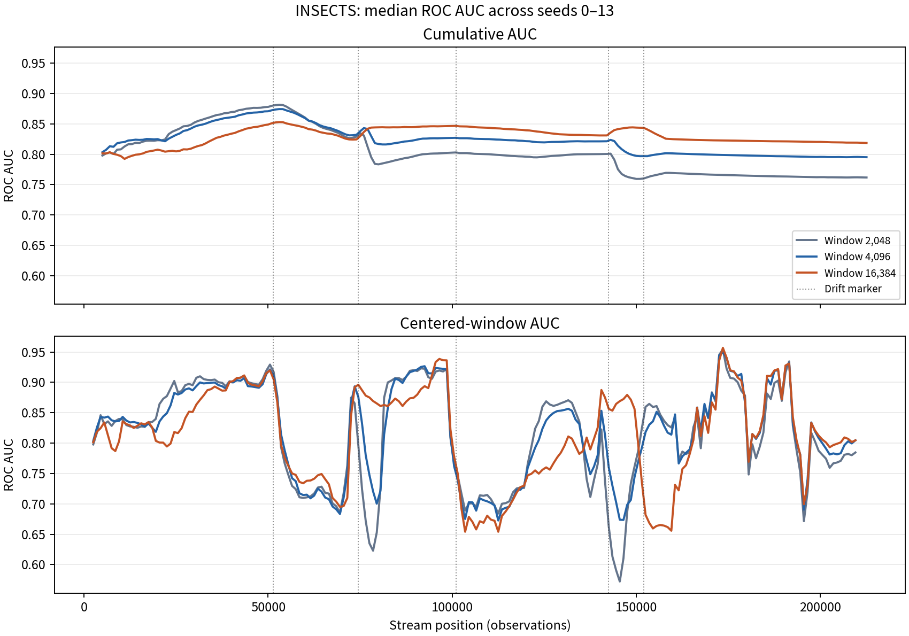
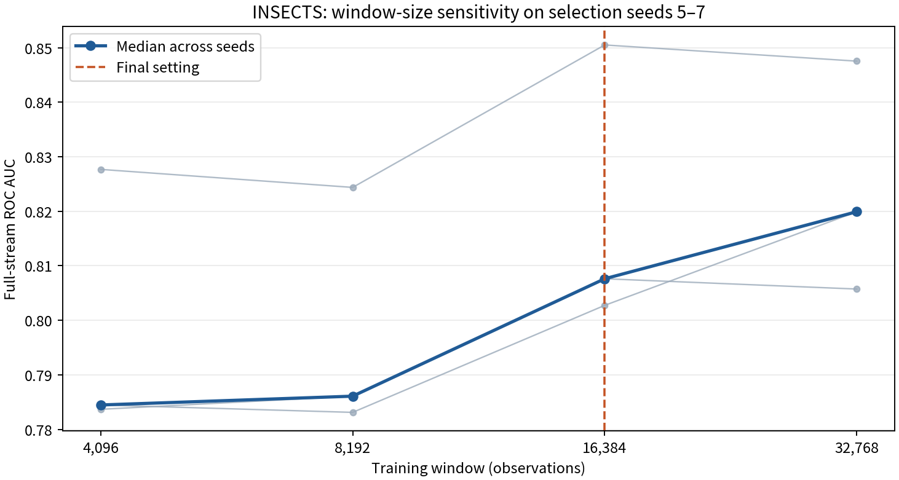

# Online Isolation Forest 實驗報告

本實驗重現 Online Isolation Forest。Annthyroid 測試樹深公式，INSECTS 測試訓練視窗大小。

## 方法

Online Isolation Forest 用多棵隨機樹隔離資料。越快被隔離的點，異常分數越高。每批先學習再評分，視窗滿了會移除最舊的資料。所有組別固定 32 棵樹、葉節點門檻 32、每批約 100 筆，沿單一特徵做二元切分。

- **Annthyroid** 有 7,200 筆、6 個特徵，異常占 7.42%。依種子打亂資料，只把深度上限從 log₄(n/32) 改成 log₂(n/32)，其中 n 為樹內有效樣本數。
- **INSECTS** 有 212,514 筆，異常占 5.51%。資料會隨時間改變，所以保留原順序，使用前 10 個特徵，只調訓練視窗。種子 0–4 用於歷史比較，5–7 選視窗，8–13 驗證。

整體 AUC 看整條資料流的排名，滑動視窗 AUC 只看附近 5,000 筆，每 1,000 筆計算一次。

## 結果

| 資料集與種子 | 原始程式 | 先前較佳設定 | 最終設定 | 最終 − 先前較佳 |
|---|---:|---:|---:|---:|
| Annthyroid 0–29 | `code` / 2048<br>0.6721 | `paper` / 2048<br>0.7458 | `paper` / 2048<br>0.7458 | 0 |
| INSECTS 0–4 | `code` / 2048<br>0.7789 | `code` / 4096<br>0.8101 | `code` / 16384<br>0.8267 | +0.0167 |
| INSECTS 8–13 | `code` / 2048<br>0.7549 | `code` / 4096<br>0.7884 | `code` / 16384<br>0.8167 | +0.0283 |

每格列出「深度模式 / 訓練視窗」及整體 ROC AUC 中位數。原始程式用 `code` 深度和 2048 視窗。`paper` 只改用論文的樹深公式。先前較佳指這輪之前已找到的設定。Annthyroid 的先前較佳與最終共用同一組 `paper` 結果，差值為 **0**。和原版 `code` 配對比較，`paper` 在 26/30 個種子上勝出。

INSECTS 的 **2048 是原版**，**4096 是事先指定的驗證基準**，16384 是最終設定。16384 在驗證種子上 6/6 勝，雙側配對 Wilcoxon p = 0.03125。2048 在這組種子是補充對照。[驗證計畫](experiment_evidence/plan.json) · [逐 seed 數據](experiment_evidence/paired_auc.csv)



*圖 1。上排看從起點累積的 AUC，下排看局部 AUC。虛線標出分布改變的位置。*

從 4096 改為 16384 時，驗證組平均滑動視窗 AUC 為 **0.8130 → 0.8106**。它在跨分布區段的排名較好，卻在同區段內下降，所以兩種 AUC 可以往不同方向變動。相較 4096，16384 的資料保留上限是四倍。同機單次測量，學習和評分時間是 1.38 倍，整個行程的峰值記憶體相差 +0.23 MiB。[成本數據](experiment_evidence/cost/)



*圖 2。淺線是各種子，深線是中位數。補測時，32768 對 16384 只贏了 1/3。最終仍用已驗證的 16384。*

多視窗集成也有測試，但兩個資料集都輸給各自較好的單視窗設定。[補充實驗](improvements.md)

## 限制與重跑

比較只涵蓋兩份資料。INSECTS 的驗證換了亂數種子，資料流仍相同。先學習再評分的結果反映同一批資料的表現。

```bash
python experiments/run_experiment.py --dataset data/stationary/ifor/Annthyroid.csv --depth-limit paper --runs 30 --tag final_paper
python experiments/run_experiment.py --dataset data/non-stationary/kqt/insects_ae-aegypti-female_cx-quinq-male_ae-albopictus-male.csv --window 16384 --no-shuffle --max-features 10 --runs 5 --tag final_w16384
```

參考文獻　Leveni et al., *Online Isolation Forest*, ICML 2024。
