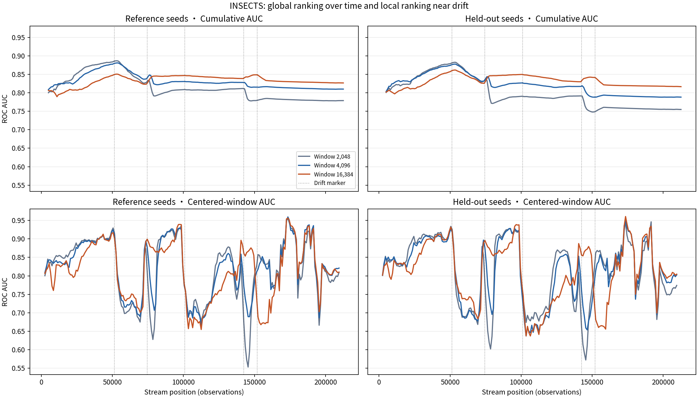
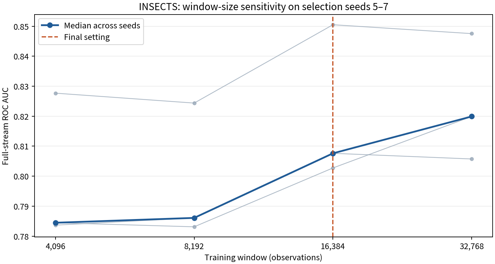

# Online Isolation Forest 實驗報告

Annthyroid 只將樹的深度上限切換成論文公式，整體 ROC AUC 中位數從 **{{ann_start}} 升到 {{ann_final}}**（絕對差／相對差 {{ann_delta}}）。這也是先前較好的設定，其他視窗沒有顯示穩定改善。INSECTS 只將訓練視窗改為 16384 筆，原版、既有 4096、最終設定的整體 AUC 依序為 **{{insect_start}}、{{insect_previous}}、{{insect_final}}**（相較 4096 為 {{insect_delta}}）。另以未參與選參數的種子驗證，整體 AUC 為 {{insect_heldout}}，平均滑動視窗 AUC 則為 {{heldout_local}}。16384 的資料保留上限為 4096 的四倍，實測成本見下表。多視窗集成未納入最終設定。

## 背景與評估方式

Online Isolation Forest 以多棵隨機隔離樹估計異常程度。每批資料進來時，各樹更新節點統計，將超出訓練視窗的舊樣本從統計中移除，再以隔離路徑長度計算分數。通常越快被隔離的觀測，異常分數越高。視窗大小決定模型最多保留多少近期樣本。深度上限限制一條路徑能切分多細，葉節點門檻控制何時允許切分。

本專案使用二元、軸平行切分、32 棵樹、葉節點門檻 32、約 100 筆一批。深度公式依樹內有效樣本數 n 調整，原版使用 log₄(n/32)，論文深度使用 log₂(n/32)，樣本數小於門檻時上限為零。n = 2048 時兩式分別得到 3 和 6。當 INSECTS 增大視窗，**深度模式與公式**仍用原版，代入的有效樣本數會改變，所以實際深度上限也可能隨視窗變大。這是視窗參數在現有模型中的作用。

| 資料集 | 實際筆數 | CSV 原始特徵數 | 模型使用 | 異常筆數及比例 |
|---|---:|---:|---:|---:|
{{label_facts}}

Annthyroid 是靜態甲狀腺異常資料，評估前按種子打亂。INSECTS 由飛行聲學特徵構成，兩類較常見樣本視為正常，較少的一類視為異常。溫度改變會影響飛行行為和特徵分布，因此保留時間順序，沿用前 10 個特徵。圖中的 drift 標記位於第 {{drift_positions}} 筆，取自專案既有的 oracle 設定。標記只用於分析曲線，最終模型照原流程連續更新。

**整體 AUC**衡量整條資料流中，任取一筆異常與一筆正常時，異常分數較高的機率，同分計半。它也比較來自不同時期的分數。**滑動視窗 AUC**只比較以各位置為中心的附近樣本，本報告採寬 {{eval_width}}、步長 {{eval_step}}，先跨種子取各點中位數，再將曲線沿時間平均。**累積 AUC**則從起點累積到圖上每個位置，末點等於整體 AUC。三種計算的配對集合不同，因此整體 AUC 和平均滑動視窗 AUC 可以朝相反方向移動。

評估維持原專案的「先學習當批，再為當批評分」。標籤用於計算指標。此批次順序會影響結果的部署解讀。

## 主要結果

Annthyroid 的先前較好與最終共用同一個 paper 深度組，因此只有一個統計對照。INSECTS 的三組為訓練視窗 2048、4096、16384。下表的相對差等於絕對 AUC 差除以對照的中位數。不同 seed 組的結果各自比較。

| 資料集與種子 | 原版中位數 | 先前較好 | 最終 | 較好 − 原版（絕對／相對） | 最終 − 原版（絕對／相對） | 最終 − 較好（絕對／相對） |
|---|---:|---:|---:|---:|---:|---:|
{{main_rows}}

| 資料集與設定 | 種子數 | 中位數 | 平均 ± 樣本標準差 | Q1–Q3 | IQR |
|---|---:|---:|---:|---:|---:|
{{stat_rows}}

同一種子配對，對差值做雙側 Wilcoxon signed-rank。勝出指同種子 AUC 嚴格大於對照。p 值未做多重比較校正，主要關注事先鎖定的 INSECTS 4096 → 16384 驗證。中位數的差和配對差的中位數各自有不同意義。

| 同種子比較 | 勝出比例 | 輸 | 平手 | 配對差中位數 | p 值 |
|---|---:|---:|---:|---:|---:|
{{pair_rows}}

## 視窗趨勢與時間曲線

**圖 1。** 上排看累積 AUC 的終點和差距何時出現。下排看局部排序是否同步改善，以及虛線所示 drift 位置兩側有無變化。左欄是原先種子，右欄是未參與選參數的種子。各曲線是逐位置的種子中位數。評估窗使用中心附近的前後樣本，適合事後診斷。

| INSECTS 種子 | 訓練視窗 | 平均滑動視窗 AUC | 最低滑動視窗 AUC |
|---|---:|---:|---:|
{{local_rows}}

**圖 2。** 淺線連接同一個 seed，深線是中位數。看放大視窗帶來的收益是否一致，以及 32768 落在什麼位置。既有選擇在 4096、8192、16384 之間完成並已鎖定。32768 在本輪用相同選擇 seeds 補作趨勢描述。

| 訓練視窗 | 來源 | 種子數 | AUC 中位數 | 平均 ± 樣本標準差 | Q1–Q3 | IQR |
|---|---|---:|---:|---:|---:|---:|
{{sweep_rows}}

補齊趨勢後，這組選擇 seeds 的最高中位數在 {{sweep_peak}}，32768 的中位數為 {{sweep_extra}}。直接同種子對照，32768 勝過 16384 的比例為 {{sweep_extra_wins}}。這項補測用來描述哪個 seed 受益，鎖定的最終設定維持 16384。

## 為什麼會出現這些結果

**Annthyroid。** 論文深度在相同資料排列與種子下提升 AUC。程式中的論文公式允許更深的切分，讓原本可能落在同一片葉節點的樣本有機會取得不同分數。配對結果支持這次改公式的效益。較深的樹捕捉到更細的局部結構是由程式和結果推導的**假說**，本輪未測量實際樹深、特徵切分或分數並列率。既有對照將 paper 的訓練視窗從 2048 改為 8192，在另一組種子上得到 {{ann_alt}}、{{ann_alt_wins}} 勝、p = {{ann_alt_p}}。8192 超過這份資料的總筆數，整段流都不觸發容量淘汰。在打亂後的靜態資料上，保留更多早期樣本沒有固定的時序優勢。在較長資料流中是否改善排名仍是待驗證的假說。

**INSECTS。** 16384 提高未參與選擇 seeds 的整體 AUC，平均滑動視窗 AUC 略降。較長的歷史可能使稀少樣本附近的估計較穩定，或使跨時期的分數更容易排序。另一方面，drift 後較長的歷史仍包含較多舊分布，可能使局部適應變慢。較長視窗也透過有效樣本數改變實際深度上限與分數正規化，這份對照無法拆開各機制的因果貢獻。

圖 1 允許同時檢查累積與局部曲線。下表將整體 AUC 拆成 drift 標記所界定的同區段及跨區段配對。每類先按正常／異常配對數聚合，再跨驗證 seeds 取中位數。

| 訓練視窗 | 同 drift 區段內的配對 AUC | 跨 drift 區段的配對 AUC | 全流配對中跨區段的比例 |
|---|---:|---:|---:|
{{segment_rows}}

長視窗的跨區段配對 AUC 中位數差為 {{across_delta}}，同區段內則為 {{within_delta}}。跨時期的配對佔全流配對的大部分。這些排序變化提供了整體 AUC 上升、局部指標未同步提升的實證。兩種區段配對的跨種子中位數各自計算，不能直接加權還原全流中位數。

下表比較每個標記最近的、完全落在前後各自區段內的評估窗。末欄是 16384 相對 4096 的差距在標記後減去標記前。負數代表長視窗的相對表現變差。

| Drift 位置 | 最近純前／純後評估窗中心 | 4096 局部 AUC 前 → 後 | 16384 局部 AUC 前 → 後 | 差中之差 |
|---:|---:|---:|---:|---:|
{{drift_rows}}

相對表現變差的標記為 {{drift_worse}}，最大降幅出現在 {{worst_drift}} 附近，最大改善則在 {{best_drift}} 附近。這是固定位置的描述性比較，較長記憶會拉長某些 drift 後的恢復時間仍是**假說**。整體 AUC 對跨區段配對敏感，是可從實際分數驗證的指標機制。

**多視窗集成。** 舊實驗把 32 棵樹拆給 2048 與 4096 兩個視窗，各 16 棵，合併各子森林的異常分數。同樣的總樹數下，兩邊都需要保留自己的資料窗。較小視窗的估計與長視窗不同，平均可能削弱較強的分數排序訊號，這是集成沒有超越較佳單視窗的可能機制。實際對照如下。

| 資料集與對照 | 對照整體 AUC 中位數 | 集成整體 AUC 中位數 | 集成勝出 | 雙側 p |
|---|---:|---:|---:|---:|
{{multi_rows}}

INSECTS 的平均滑動視窗 AUC 從原版到集成為 {{multi_local}}，單用 4096 則為 {{multi_long_local}}。集成在兩個資料集都落後於當時各自的較佳設定，並增加一套視窗的管理成本。

## 時間與記憶體成本

在同一 Linux 實例逐一執行各設定的 seed 0，使用獨立 Python 行程。學習加評分時間沿用實驗程式的計時範圍。每筆延遲是該時間除以資料筆數的**攤銷處理時間**。載入至 AUC 時間包含讀檔、建模和 AUC 計算，到保存結果前停止。峰值 RSS 包含直譯器、函式庫、完整資料、模型及評估陣列。本表是每設定一次的同機對照，尚無單筆請求的尾端延遲或純模型記憶體。

| 設定 | 學習＋評分秒 | 載入到 AUC 秒 | 攤銷 μs／筆 | 峰值 RSS MiB |
|---|---:|---:|---:|---:|
{{cost_rows}}

此次量測中，INSECTS 16384 的學習與評分時間是 4096 的 {{cost_ratio}} 倍，行程峰值 RSS 差為 {{rss_delta}} MiB。資料容量和整個行程的 RSS 使用不同分母。多視窗組保留既有 AUC 結果，當時缺少同條件的峰值 RSS。

## 差異、來源及限制

- **主 AUC 與指定摘要比對。** 以下用同一精度核對指定值。Annthyroid 在額外種子中的中位數不同，原因是種子範圍不同。
- **依種子組核對滑動視窗 AUC。** 4096 → 16384 的原先 seeds 為 {{original_local}}，驗證 seeds 為 {{heldout_local}}。兩組依相同評估窗計算，差異對應於各組種子的逐點分數。
- **資料版本。** 論文表列 Annthyroid 6,832 筆及 7.00% 異常，本研究以公開程式所附實際 CSV 為準。INSECTS 的異常比例以 CSV 標籤計算，論文正文寫 5.50%。論文描述 INSECTS 原始資料有 33 個特徵，Figure 7 的曲線使用 30 次執行，本專案使用前 10 特徵，歷史組與驗證組分別為 5 和 6 次。
- **選擇與評估。** 原先 INSECTS seeds 0–4 曾用於較早的視窗研究，適合展示歷史同種子比較。16384 是在 seeds 5–7 的三個既有視窗中選定，鎖定後才以 seeds 8–13 與 4096 驗證。新增 2048 使用相同驗證 seeds，供完整對照。這減少了用同一批亂數選設定並驗證的偏差，資料流本身相同。Annthyroid 的主要比較也是此前已做過的實驗。
- **泛化。** 僅涵蓋兩個資料集，且 INSECTS 每組 seed 數少。未觀察獨立串流、其他飄移類型或先評分後更新的效能。重疊評估窗彼此相依，drift 診斷沒有以各視窗為獨立樣本做顯著性檢定。

| 比較 | 指定摘要 | 原始紀錄重算 | 差異 |
|---|---:|---:|---|
{{claim_rows}}

參考文獻為 Leveni 等人，*Online Isolation Forest*，ICML 2024，§4、§5、Figure 7。資料與設定來源如下。

| 既有來源 | 用途 |
|---|---|
| [歷史結果與多視窗對照](experiment_evidence/paired_auc.csv) | 逐 seed AUC 和來源摘要位置 |
| [Annthyroid 舊視窗結果](experiment_evidence/paired_auc.csv) | 逐 seed CSV 的 additional_ann_validation 組 |
| [INSECTS 視窗選擇](experiment_evidence/locked-selection.json) | 驗證前的 16384 鎖定紀錄 |
| [隨附實驗證據](experiment_evidence/README.md) | 來源說明、逐 seed 摘要、成本與驗證證據 |
| [成本量測](experiment_evidence/cost/) | 本輪獨立行程量測紀錄 |

## 重現

在專案根目錄使用已準備的虛擬環境。下列每行對應一個結果或同一設計下的掃描，重跑輸出放在獨立目錄。Annthyroid 的 paper 組同時是先前較好與最終組。歷史多視窗組使用既有結果。

~~~bash
source .venv/bin/activate
export OPENBLAS_NUM_THREADS=1 OMP_NUM_THREADS=1 MPLCONFIGDIR="$PWD/results/experiment_report/matplotlib"
ann={{ann_path}}
insects={{insect_path}}
repro=results/experiment_report/reproduce

python experiments/run_experiment.py --dataset "$ann" --depth-limit code --seed 0 --runs 30 --tag ann_code --out "$repro"
python experiments/run_experiment.py --dataset "$ann" --depth-limit paper --seed 0 --runs 30 --tag ann_paper --out "$repro"
for w in 2048 8192; do python experiments/run_experiment.py --dataset "$ann" --depth-limit paper --window "$w" --seed 35 --runs 10 --tag "ann_prior_validation_w$w" --out "$repro" || break; done
python experiments/run_experiment.py --dataset "$insects" --no-shuffle --max-features 10 --window 2048 --seed 0 --runs 5 --tag reference_w2048 --out "$repro"
python experiments/run_experiment.py --dataset "$insects" --no-shuffle --max-features 10 --window 4096 --seed 0 --runs 5 --tag reference_w4096 --out "$repro"
python experiments/run_experiment.py --dataset "$insects" --no-shuffle --max-features 10 --window 16384 --seed 0 --runs 5 --tag reference_w16384 --out "$repro"
python experiments/run_experiment.py --dataset "$insects" --no-shuffle --max-features 10 --window 2048 --seed 8 --runs 6 --tag validation_w2048 --out "$repro"
python experiments/run_experiment.py --dataset "$insects" --no-shuffle --max-features 10 --window 4096 --seed 8 --runs 6 --tag validation_w4096 --out "$repro"
python experiments/run_experiment.py --dataset "$insects" --no-shuffle --max-features 10 --window 16384 --seed 8 --runs 6 --tag validation_w16384 --out "$repro"
for w in 4096 8192 16384 32768; do python experiments/run_experiment.py --dataset "$insects" --no-shuffle --max-features 10 --window "$w" --seed 5 --runs 3 --tag "sweep_w$w" --out "$repro" || break; done
for d in code paper; do python experiments/profile_report.py --dataset "$ann" --depth-limit "$d" --output "$repro/cost/ann_$d" || break; done
for w in 2048 4096 16384 8192 32768; do python experiments/profile_report.py --dataset "$insects" --no-shuffle --max-features 10 --window "$w" --output "$repro/cost/insects_w$w" || break; done
python experiments/report_analysis.py
python experiments/report_analysis.py --check
~~~

最後兩行使用實驗工作區的原始附件與逐點分數重建或比對本文和圖。GitHub 隨附的是逐 seed 摘要與驗證證據。獨立重跑的檔案寫入 reproduce，可和表格使用的原始結果另行配對。

## 交付前自我驗證

- [x] **數字由腳本重算並比對。** 分析腳本從 {{verified_runs}} 份實驗 NPZ 重算 AUC，另核對 {{cost_count}} 份成本／重跑 NPZ，再比對既有集成和 INSECTS 驗證表。主要數字由原始資料填入模板，背景的論文數字與執行設定分別來自論文和設定紀錄。[驗證輸出](experiment_evidence/verification.json)。
- [x] **最終設定已從頭重跑。** seed 0 各自重新從 CSV 載入、建模、訓練與評估，和相同 seed 的既有分數及標籤逐項比對。主要中位數仍用對應的完整種子組。

| 重跑設定 | 重跑 seed 0 AUC | 原始 seed 0 AUC | 逐點分數最大絕對差 |
|---|---:|---:|---:|
{{repeat_rows}}

- [x] **每項結論都有機制與證據。** 「為什麼」一節連結深度公式、配對結果、全流配對分解、drift 時間曲線及既有集成紀錄，未拆出的因果機制標為假說。
- [x] **每張圖都有引用與讀法。** 圖 1 與圖 2 均在正文顯示，圖說分別指出要看累積與局部指標，以及個別種子與視窗敏感度。
- [x] **模型程式保持盤點時的內容。** 實驗期間前後的 git diff --stat 一致。下方是當時的盤點結果，三個追蹤檔的差異在實驗前已存在。GitHub 最終版另更新了首頁與證據連結。另核對 {{source_count}} 份受保護檔的 SHA-256，包括未追蹤的多視窗程式與測試。未追蹤的新增檔不在一般 git diff --stat 內。[盤點雜湊](experiment_evidence/source-before.sha256)。

~~~text
{{source_diff}}
~~~

陌生讀者可能會問這三個問題。

1. **「只改一個參數，為什麼實際樹深還會變？」** 背景說明深度公式取決於有效樣本數，以及 INSECTS 保留原版公式的含義。
2. **「整體 AUC 變高，為什麼 drift 附近可能變差？」** 指標定義、圖 1、跨區段配對表及 drift 前後表回答排名配對的差別，並區分觀察與機制假說。
3. **「比較是否公平，收益需要多少成本？」** 主結果與限制列出同種子配對、先鎖設定再驗證、評估順序，以及同機時間和 RSS 的計量方式。
