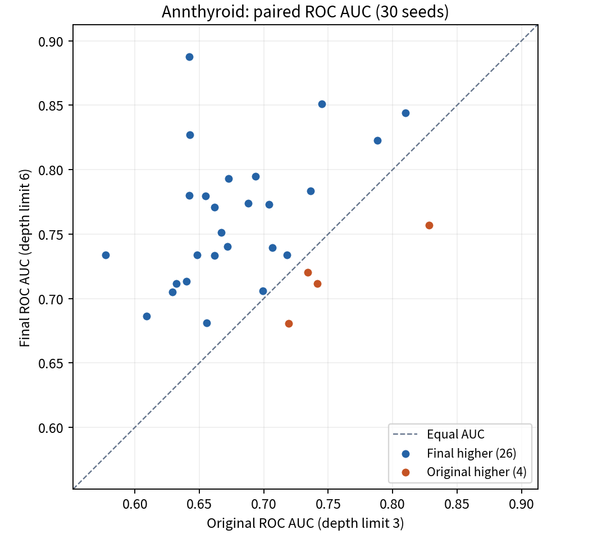

# Online Isolation Forest 實驗報告

本實驗重現 Online Isolation Forest。Annthyroid 測試樹深公式，INSECTS 測試訓練視窗大小。

## 方法

Online Isolation Forest 用多棵隨機樹隔離資料。越快被隔離的點，異常分數越高。每批先學習再評分，視窗滿了會移除最舊的資料。所有組別固定 32 棵樹、葉節點門檻 32、每批約 100 筆，沿單一特徵做二元切分。

- **Annthyroid** 有 7,200 筆、6 個特徵，異常占 7.42%。依種子打亂資料，只把深度上限從 log₄(n/32) 改成 log₂(n/32)，其中 n 為樹內有效樣本數。
- **INSECTS** 有 212,514 筆，異常占 5.51%。資料會隨時間改變，所以保留原順序，使用前 10 個特徵，只調訓練視窗。三組設定使用相同的 14 個種子（0–13），其中部分種子也曾用來挑選視窗。

整體 AUC 看整條資料流的排名，滑動視窗 AUC 只看附近 {{eval_width}} 筆，每 {{eval_step}} 筆計算一次。

## 結果

| 資料集與種子 | 原始程式 | 先前較佳設定 | 最終設定 | AUC 差（最終 − 原版） |
|---|---:|---:|---:|---:|
{{main_rows}}

每格列出滿視窗時的深度上限、訓練視窗大小和整體 ROC AUC 中位數。原始公式（`code`）在 2048 筆時算出 3，論文公式（`paper`）算出 6。3.5 和 4.5 是分裂門檻，節點深度仍是整數。Annthyroid 的先前較佳與最終共用同一組 `paper` 結果。和原版 `code` 配對比較，`paper` 在 {{ann_wins}} 個種子上勝出。



*圖 1。每點代表一個種子。點在虛線上方代表改用深度上限 6 後 AUC 提高。*

INSECTS 的原版、先前較佳設定和最終設定分別是 2048、4096 和 16384。表中是各設定 14 次實驗的 AUC 中位數。[逐 seed 數據](experiment_evidence/paired_auc.csv)


*圖 2。種子 0–13 的 AUC 中位數。上排是累積 AUC，下排是滑動視窗 AUC。虛線標出資料分布改變的位置。*

從 4096 改為 16384 時，平均滑動視窗 AUC 為 **{{pooled_local}}**。相較 4096，16384 的資料保留上限是四倍。同機單次測量，學習和評分時間是 {{cost_ratio}} 倍，整個行程的峰值記憶體相差 {{rss_delta}} MiB。[成本數據](experiment_evidence/cost/)

多視窗集成的 AUC 低於各資料集先前較佳的單視窗設定。[補充實驗](improvements.md) · [選視窗時的比較](../figures/insects_window_sweep.png)

## 限制與重跑

比較只涵蓋兩份資料。INSECTS 的 14 個種子都使用同一條資料流。先學習再評分的結果反映同一批資料的表現。

```bash
python experiments/run_experiment.py --dataset {{ann_path}} --depth-limit paper --runs 30 --tag final_paper
python experiments/run_experiment.py --dataset {{insect_path}} --window 16384 --no-shuffle --max-features 10 --runs 14 --tag final_w16384
```

參考文獻　Leveni et al., *Online Isolation Forest*, ICML 2024。
