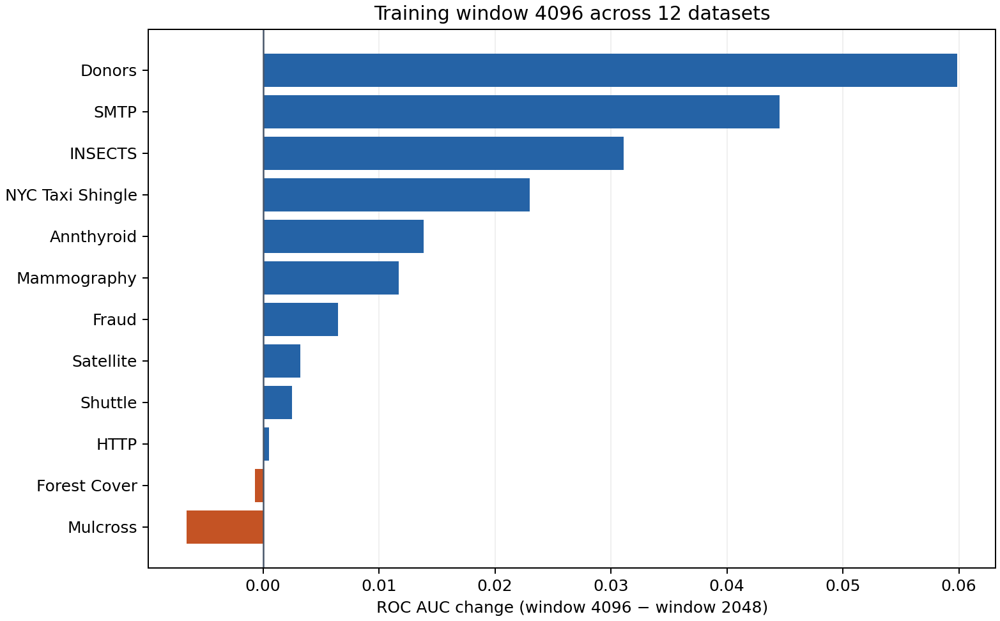

# 訓練視窗 2048 與 4096

把原始程式的訓練視窗從 2048 改為 4096，切分門檻 η 固定 32。深度門檻仍用原始程式的 log₄ 公式，滿視窗時對應的數值為 3 與 3.5。模型每批更新後最多保留 4096 筆。先前 INSECTS 的整體 AUC 在 4096 時有提升，因此選它做跨資料集驗證。

實驗使用 11 份靜態資料及 INSECTS。兩組都用 32 棵樹、每批約 100 筆，並用相同的種子 0–4 配對。靜態資料依種子打亂，INSECTS 保留原順序並使用前 10 個特徵。[資料來源](https://github.com/ineveLoppiliF/Online-Isolation-Forest/tree/e528c86b77219791d026d732f618efb0c7bde3c1/datasets)

## 結果

| 資料集 | 筆數 | 視窗 2048 AUC | 視窗 4096 AUC | AUC 差值 | 視窗 4096勝出 |
|---|---:|---:|---:|---:|---:|
| Donors | 619,326 | 0.7469 | 0.8068 | +0.0599 | 2/5 |
| HTTP | 567,498 | 0.9965 | 0.9970 | +0.0005 | 4/5 |
| Forest Cover | 286,048 | 0.8736 | 0.8729 | -0.0007 | 1/5 |
| Fraud | 284,807 | 0.9393 | 0.9457 | +0.0064 | 5/5 |
| Mulcross | 262,144 | 0.9954 | 0.9888 | -0.0066 | 0/5 |
| SMTP | 95,156 | 0.8107 | 0.8552 | +0.0445 | 5/5 |
| Shuttle | 49,097 | 0.9901 | 0.9926 | +0.0025 | 5/5 |
| Mammography | 11,183 | 0.8406 | 0.8523 | +0.0117 | 4/5 |
| NYC Taxi Shingle | 10,273 | 0.5706 | 0.5935 | +0.0230 | 5/5 |
| Annthyroid | 7,200 | 0.6992 | 0.7130 | +0.0138 | 4/5 |
| Satellite | 6,435 | 0.6555 | 0.6587 | +0.0032 | 4/5 |
| INSECTS | 212,514 | 0.7789 | 0.8101 | +0.0311 | 5/5 |

表中 AUC 是各設定 5 次的整體 ROC AUC 中位數，差值為 視窗 4096 減 視窗 2048。勝出次數用相同種子逐對比較。

以「過半數資料集提升，且等權平均差值大於零」判斷整體改善。結果為 **10 份提升、2 份下降、0 份持平**，差值中位數為 **+0.0091**。每份資料等權平均的差值為 +0.0158。這個設定在多數資料集上提升 AUC，仍有資料集退步。



圖中右側代表 AUC 提升，左側代表下降。每份資料只跑 5 個種子，反映同一批資料在不同亂數下的結果。這裡比較整體 AUC。INSECTS 的滑動視窗 AUC 與 14 個種子的視窗實驗另有紀錄。[個別實驗](experiment_report.md)

## 重跑

```bash
OPENBLAS_NUM_THREADS=1 OMP_NUM_THREADS=1 python experiments/depth_benchmark.py --candidate-window 4096
python experiments/depth_benchmark_report.py --candidate-window 4096
```

[逐種子 AUC](experiment_evidence/window_seed_auc.csv)
